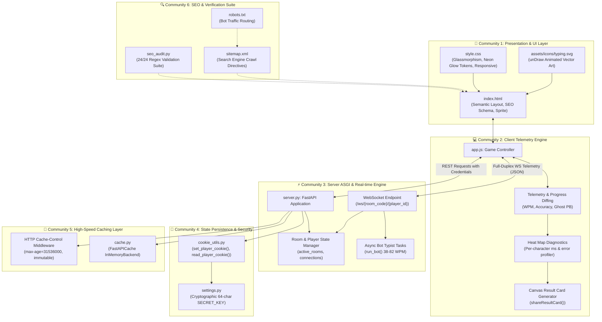
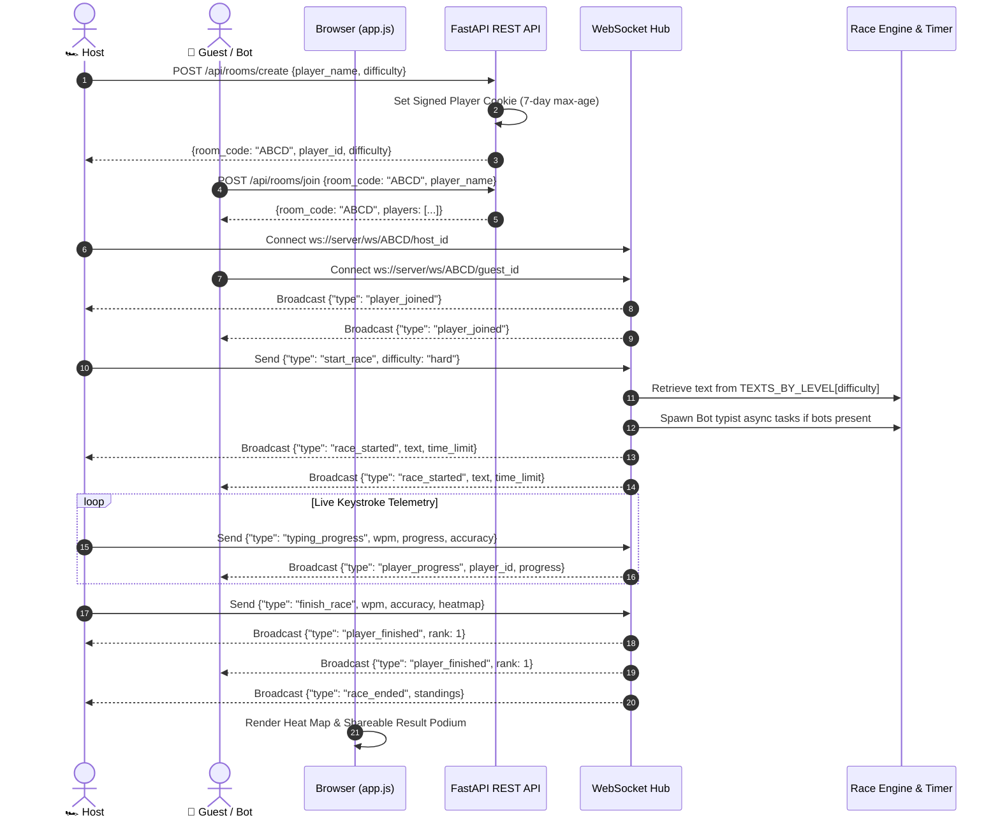

# ⚡ NeonType Race

> **A high-octane, real-time multiplayer typing race game built with FastAPI, WebSockets, and modern Cyberpunk Glassmorphism UI.**  
> Featuring character-level heat maps, AI bot typists, ghost personal bests, dynamic difficulty pools, signed cookie persistence, and high-performance in-memory caching.


<div align="center">

[](https://fastapi.tiangolo.com/)
[](https://www.python.org/)
[](https://developer.mozilla.org/en-US/docs/Web/API/WebSockets_API)
[](#-caching--performance)
[](#-seo--search-engine-optimization)
[](https://render.com/)
[](LICENSE)

[🎮 Play Live Demo](https://neontype-race-1.onrender.com/) • [📊 View Architecture](#-graphify-knowledge-graph--system-architecture) • [🚀 Quick Start](#-quick-start--local-setup) • [🔍 SEO & Audit](#-seo--search-engine-optimization)

</div>

---

## 🌟 Highlights & UI/UX Features

- 🏎️ **Real-Time Multiplayer Racing**: Host or join private lobby rooms with up to **4 players** using full-duplex WebSockets.
- 🟢 **Dynamic Difficulty Pools**: Choose between **Easy**, **Medium**, and **Hard** paragraphs across **45+ curated texts** spanning conversational English, modern literature, blockchain, quantum computing, and systems engineering.
- 🔥 **Character-Level Heat Map**: Post-race performance heat map visualizing per-character keystroke latencies (Fast, Normal, Slow, Very Slow) and pinpointing error keys.
- 🤖 **AI Bot Typists**: Host solo races against intelligent bot typists (**Turbo Bot**, **Nitro Bot**, **Vector Bot**) with human-like speed variances between 38 and 82 WPM.
- 👻 **Ghost Personal Best (PB)**: Live ghost racer tracks your personal best run in real time directly on your race track.
- 🍪 **Signed Cookie Preference Persistence**: Automatically remembers your player name and preferred difficulty across sessions using cryptographic 7-day signed cookies (`itsdangerous`).
- ⚡ **High-Speed Caching**: Zero-latency static asset responses with HTTP `immutable` cache headers and in-memory server state caching.
- 👁️ **Spectator Mode**: Join live active races in progress as a ghost spectator with real-time HUD telemetry.
- 📱 **Responsive Mobile Design**: Virtual keyboard viewport auto-centering, touch-friendly controls, and custom glassmorphism design tokens.
- 🎨 **Futuristic Neon Aesthetics**: Ambient glowing orbs, unDraw vector illustrations, customized scrollbars, and typography powered by `Inter` and `Fira Code`.

---

## 📊 Competitive Analysis Matrix

How **NeonType Race** compares directly against industry typing games (**TypeRacer**, **TypeRush**, **TypingGames.Zone**):

| Feature / Metric | 🏎️ TypeRacer (`play.typeracer.com`) | 🚗 TypeRush (`typerush.com`) | 🏁 TypingGames.Zone | ⚡ **NeonType Race** |
| :--- | :--- | :--- | :--- | :--- |
| **User Interface** | ⚠️ Web 1.0 layout, ad-cluttered | 🟡 Flash-style, crowded | 🔴 Ad-heavy iframe wrapper | **🏆 Modern Cyberpunk Glassmorphism, Zero Ads** |
| **Character Heat Map** | ❌ None | ⚠️ Basic tricky keys summary | ❌ None | **🏆 Full per-character latency & error heat map** |
| **Difficulty Selection** | ❌ Random quotes only | ❌ Fixed difficulties | ❌ Fixed games | **🏆 3 Difficulty tiers (Easy / Medium / Hard, 45+ passages)** |
| **Offline / Practice Bots** | ❌ No true AI bots | ⚠️ Simple fixed cars | ❌ None | **🏆 Real-time dynamic AI bots (38–82 WPM)** |
| **Mobile Experience** | ⚠️ Not optimized | 🟡 Basic | 🔴 Broken on small viewports | **🏆 Viewport keyboard centering + touch controls** |
| **Technical SEO** | ⚠️ Missing structured schema | ❌ None | ❌ None | **🏆 Schema.org `WebApplication` JSON-LD + 2,250 keywords** |
| **In-Memory Caching** | 🟡 Third-party ad scripts | 🟡 Moderate load time | 🔴 Slow | **🏆 In-memory state cache + HTTP immutable headers** |
| **User Persistence** | ⚠️ Requires account creation | ⚠️ Requires account | ❌ No persistence | **🏆 Instant signed cookies (No signup required)** |

---

## 🧠 Graphify Knowledge Graph & System Architecture

The codebase has been analyzed and extracted using **Graphify AST Knowledge Graph Extraction** into **124 AST nodes**, **239 relationships**, and **6 core modular communities**:



---

## 🔄 Real-Time Event Sequence



---

## 📁 Repository Structure

```
typing-race/
├── index.html         # Main interface, SVG sprite, SEO schema & metadata
├── style.css          # Glassmorphism styling, neon tokens, button glow effects
├── app.js             # Client SPA controller, WebSocket telemetry & ghost engine
├── server.py          # FastAPI application, room manager & WebSocket hub
├── cache.py           # In-memory caching engine using fastapi-cache2
├── cookie_utils.py    # Signed cookie utilities for player preference persistence
├── settings.py        # Cryptographic key manager
├── seo_audit.py       # Regex SEO verification test suite (24 audit checks)
├── sitemap.xml        # Search engine sitemap
├── robots.txt         # Search engine crawler policies
├── bg.jpg             # High-resolution cyberpunk neon backdrop
├── assets/
│   └── icons/
│       └── typing.svg # unDraw animated vector typing artwork
├── requirements.txt   # Python dependency specifications
├── render.yaml        # Render cloud service deployment configuration
└── vercel.json        # Vercel SPA routing configuration
```

---

## 🚀 Quick Start & Local Setup

### Prerequisites
- **Python 3.10+**
- **pip** package manager
- Any modern web browser

### 1. Clone the Repository
```bash
git clone https://github.com/pranav-4797/NeonType_Race.git
cd NeonType_Race
```

### 2. Set Up Python Virtual Environment
**On Windows:**
```bash
python -m venv venv
venv\Scripts\activate
```

**On macOS / Linux:**
```bash
python3 -m venv venv
source venv/bin/activate
```

### 3. Install Dependencies
```bash
pip install -r requirements.txt
```

### 4. Run the Backend Server
```bash
uvicorn server:app --reload --host 0.0.0.0 --port 8000
```
*The server will start on `http://localhost:8000` with WebSockets enabled.*

### 5. Launch the Frontend
Open `index.html` directly in your browser or run:
```bash
python -m http.server 3000
```
Open `http://localhost:3000` to race!

---

## 🔍 SEO & Search Engine Optimization

NeonType Race is optimized for search engines to challenge competitors like TypeRacer and TypeRush:

- **2,250 Curated Target Keywords** embedded in metadata.
- **Schema.org Structured Data**: Validated `WebApplication` JSON-LD schema with ratings and requirements.
- **Social Graph Open Graph & Twitter Cards**: High-resolution preview cards for Facebook, LinkedIn, Discord, and X.
- **Crawlable Semantic Content**: Accessible `<article class="seo-content">` crawlable by Googlebot.

### Run the SEO Audit Test
Verify on-page compliance anytime:
```bash
python seo_audit.py
```

Output:
```text
======================================================================
       [NEONTYPE RACE - REGEX SEO & AUDIT VERIFICATION]
======================================================================
  [PASS] OK: Page Title Tag (30-70 chars)
  [PASS] OK: Meta Description (100-250 chars)
  [PASS] OK: Meta Keywords (2000+ words)
  [PASS] OK: Canonical URL & Robots Directives
  [PASS] OK: Open Graph & Twitter Card Directives
  [PASS] OK: JSON-LD Structured Data Schema
  [PASS] OK: Heading Hierarchy (H1, H2, H3) & Image Alt Tags
  [PASS] OK: Difficulty Selector UI & Crawlable Content Section

  Target Keywords Count in Meta Tag: 2250 keywords
  Audit Score: 24/24 checks passed (100.0% COMPLIANCE)
======================================================================
```

---

## 🔌 API & WebSocket Documentation

### REST Endpoints

| Method | Endpoint | Description |
| :--- | :--- | :--- |
| `GET` | `/health` | Health check returning status and active room count. |
| `GET` | `/api/text?level={easy\|medium\|hard}` | Retrieves a random paragraph for the selected difficulty level. |
| `GET` | `/api/player-prefs` | Reads saved name and difficulty from signed cookie. |
| `POST` | `/api/rooms/create` | Creates a room lobby, returns room code, and sets signed player cookie. |
| `POST` | `/api/rooms/join` | Joins an existing room and sets signed player cookie. |
| `GET` | `/api/rooms/{code}` | Retrieves public room status and player list. |

### WebSocket Protocol

Connect to `ws://<host>/ws/{room_code}/{player_id}`.

#### Client Events:
- `start_race`: Host initiates race with `{difficulty: "easy"|"medium"|"hard"}`.
- `typing_progress`: Transmits `{wpm, progress, accuracy}`.
- `finish_race`: Transmits final stats and per-character heatmap data.
- `add_bot`: Adds an AI bot to the lobby.
- `remove_bot`: Removes a selected bot from the lobby.
- `timeout`: Triggered when time limit expires.

#### Server Broadcast Events:
- `room_state`: Snapshot sent on connection.
- `player_joined` / `player_left`: Lobby membership changes.
- `race_started`: Transmits paragraph text, time limit, and racer slots.
- `player_progress`: Real-time rival position updates.
- `player_finished`: Racer finish rank and WPM broadcast.
- `race_ended`: Final standings and podium results.

---

## ☁️ Deployment Guide

### Backend on Render
1. Connect your repository to [Render](https://render.com/).
2. Render detects [render.yaml](file:///c:/Users/PRANAV/OneDrive/Desktop/PRANAV%20CHOPADE/typing-race/render.yaml).
3. Build Command: `pip install -r requirements.txt`
4. Start Command: `uvicorn server:app --host 0.0.0.0 --port $PORT`

### Frontend on Vercel
1. Connect your repository to [Vercel](https://vercel.com/).
2. Vercel utilizes [vercel.json](file:///c:/Users/PRANAV/OneDrive/Desktop/PRANAV%20CHOPADE/typing-race/vercel.json) for static delivery.
3. Deploy directly without requiring an additional build step.

---

## 📄 License

This project is open-source and available under the [MIT License](LICENSE).

---

## 🧑‍💻 Author

Crafted with ❤️ by **[Pranav Chopade](https://github.com/pranav-4797)**.
